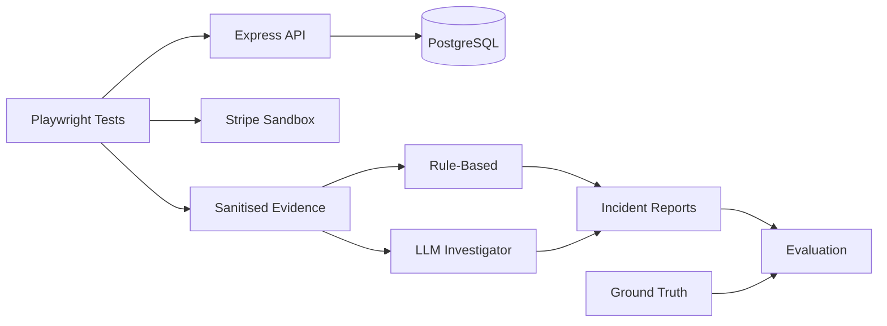
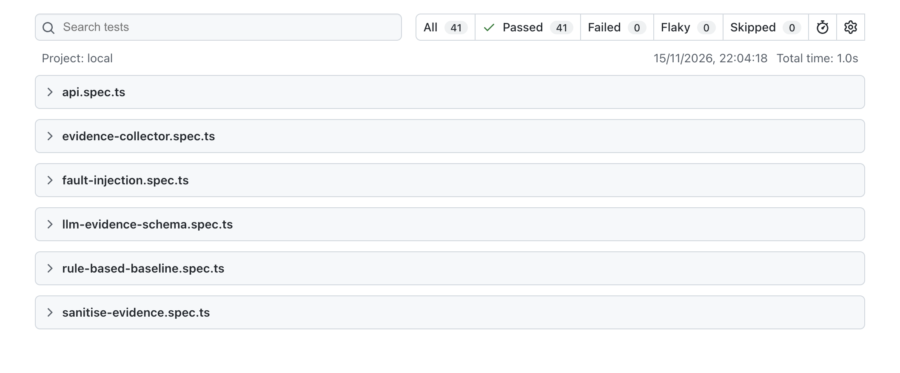

# Stripe API & AI Failure Investigator

**Automated Stripe integration testing with AI-assisted failure diagnosis.**

A TypeScript and Playwright project for testing payment APIs, webhook reliability and data consistency across Stripe Sandbox and PostgreSQL.

## What I Built

- **API & Webhook Testing:** Payment lifecycle, refunds, validation, signatures, retries, idempotency and delayed events.
- **Database Validation:** PostgreSQL assertions and Stripe-to-order consistency checks.
- **Fault Injection:** Controlled failures with diagnostic evidence and labelled ground truth.
- **AI Investigation:** Structured incident reports using OpenAI, compared with a rule-based baseline.
- **CI/CD:** GitHub Actions workflows for deterministic tests and separate Stripe Sandbox integration tests.

## Architecture



## Tech Stack

TypeScript · Node.js · Playwright · Stripe API · Express · PostgreSQL · SQL · GitHub Actions · OpenAI API · Zod

## Getting Started

Requires Node.js 22+ and npm.

```bash
git clone https://github.com/MaryPavlenko/stripe-api-ai-failure-investigator.git
cd stripe-api-ai-failure-investigator
npm ci
cp .env.example .env
npm run typecheck
npm test
```

Local tests use a fake payment gateway and require no Stripe credentials.

### Integration Tests

With PostgreSQL and Stripe Sandbox configured:

```bash
npm run test:sandbox
npx playwright test --project=postgres
npx playwright test --project=data-consistency
```

Use sandbox credentials only. Never use live payment keys.

### AI Failure Investigation

Add `OPENAI_API_KEY` to your local `.env`:

```bash
npx tsx scripts/run-ai-investigator.ts F005
```

The investigator generates a structured report with a probable root cause, supporting evidence, confidence and recommended checks. OpenAI API usage is billed separately.

## Evaluation

Five controlled failure scenarios were analysed by two investigators: **Rule-Based Baseline** and **LLM Investigator**.

An initial manual review evaluated 10 reports across symptom identification, failure classification, root-cause reasoning, uncertainty, unsupported claims and recommendations.

**Preliminary results:** Rule-Based 47/50 · LLM 49/50.

These are development-set, single-reviewer scores, not independent accuracy estimates.

- [Evaluation Findings](evaluation/initial-findings.md)
- [Failure Scenarios](evaluation/scenarios.md)
- [Evaluation Rubric](evaluation/rubric.md)
- [Example AI Incident Report — F003](examples/reports/ai-incident-F003.json)

## CI/CD

- **Fast CI:** Deterministic API and webhook tests.
- **Stripe Sandbox Integration:** Separately triggered integration tests.

AI diagnosis runs separately and does not alter test PASS/FAIL results.

### Playwright Test Report

**41 local tests passed · 0 failed**



## Limitations

This is a portfolio engineering experiment, not a production payment system.

- Uses controlled failures and Stripe test payments.
- The initial five scenarios are not an independent benchmark.
- Sanitisation reduces exposure risks but is not a complete security guarantee.
- AI diagnoses require human review.
- A larger independent evaluation and AI diagnostic CI stage are future work.

## References

[Stripe API](https://docs.stripe.com/api) · [Stripe Webhooks](https://docs.stripe.com/webhooks) · [Playwright](https://playwright.dev/) · [OpenAI API](https://platform.openai.com/docs/)
