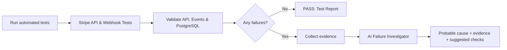

# Stripe API & AI Failure Investigator

**An automated testing pipeline for Stripe payment APIs and webhooks, with AI-assisted failure investigation.**

> **Project status — in progress (roadmap v0.3, starter code):** Existing Express/TypeScript code and 10 Playwright API tests are included but have **not been executed and verified** in the authoring environment. A minimal GitHub Actions workflow and Stripe API exploratory scripts are included. End-to-end Stripe sandbox CI, PostgreSQL cross-system assertions, failure artifacts, refunds and the AI investigator are **planned, not implemented yet**.

## The problem

Payment integrations have multiple failure points. A payment may succeed in Stripe while the merchant order remains pending; webhooks may be retried, delayed or processed incorrectly. Investigating such incidents requires correlating **Stripe API objects, webhook events, application responses and database state** rather than relying on one HTTP status.

This project aims to build a **repeatable automated testing pipeline** for a sample merchant application integrated with Stripe. It combines sandbox API exploration, **TypeScript + Playwright** checks, webhook reliability tests and cross-system SQL validation. When tests fail, the pipeline should collect sanitised evidence and separately evaluate whether AI can suggest **evidence-grounded** root causes.

## Learning and engineering scope

| Area | Activities | Status |
| --- | --- | --- |
| Stripe API exploration | Inspect objects/endpoints, make safe GET/POST calls in sandbox, read error responses | **Exercise scripts included** |
| Minimal merchant integration | Create an order and a Stripe PaymentIntent; handle signed `payment_intent.*` webhooks | **Starter code included; not verified** |
| Fast CI automated API tests | Verify order validation, webhook signature, retry/idempotency and state changes (fake gateway, in-memory store) | **10 tests and minimal workflow included; not verified** |
| Real integration + SQL | Run PostgreSQL and Stripe sandbox together, assert order and event consistency automatically | **Setup partially included; automated assertions planned** |
| Payment lifecycle and webhook reliability | Automate payment success/failure, negative cases, refunds, duplicates and retries | **Partial fake-gateway tests; extended coverage planned** |
| CI pipeline + diagnostic artifacts | Separate fast PR checks from isolated sandbox runs, store test reports and sanitised failure evidence | **Basic CI included; full workflow planned** |
| AI incident investigation | Fault injection, structured evidence, labelled ground truth, model evaluation | **Planned** |

## Architecture



**Two test lanes:** *Fast CI* on each PR uses mocked Stripe and deterministic webhook events. *Sandbox integration* exercises real Stripe API calls and signed webhook delivery separately. Both must ultimately validate application state, not only HTTP responses. The diagram is the **target**, not the current implementation. **Test assertions decide PASS/FAIL; AI only adds a diagnostic hypothesis.**

**Important:** The Stripe API isn't anonymous. It is publicly documented, but requests require sandbox credentials. The scripts below reject non-test secret keys. Do not share API keys, customer data or `client_secret` values.

## Repository map

- [`GUIDE_RU.md`](GUIDE_RU.md) — start here: step-by-step Russian study plan.
- [`docs/ru/01-stripe-api-basics.md`](docs/ru/01-stripe-api-basics.md) — concepts and API map.
- [`docs/ru/02-sandbox-api-exploration.md`](docs/ru/02-sandbox-api-exploration.md) — first safe hands-on API calls.
- [`docs/ru/03-local-app-webhooks.md`](docs/ru/03-local-app-webhooks.md) — original detailed local-app, tests, database and webhook walkthrough.
- [`docs/ru/04-automated-testing-pipeline.md`](docs/ru/04-automated-testing-pipeline.md) — detailed CI, webhook, SQL and evidence-building roadmap.
- [`docs/ru/05-ai-evaluation-plan.md`](docs/ru/05-ai-evaluation-plan.md) — planned incident experiments.
- [`examples/stripe-api/`](examples/stripe-api/) — sandbox-only `curl` exercises.
- `src/`, `tests/`, `db/` — starter application, API tests, schema.

## Prerequisites

Node.js 22+ and npm. Docker Desktop is needed only when you run PostgreSQL. A Stripe general sandbox and optional Stripe CLI are needed for real sandbox exercises. No real payments.

## Run existing deterministic tests (no Stripe key required)

```bash
npm install
npm run typecheck
npm test
```

The ten tests use `FakePaymentGateway` and `MemoryOrderStore`. They test **our application's API and webhook handling**, not Stripe's own production platform. Passing them doesn't validate a real Stripe integration. Run them locally before marking them as passing.

## Try the public Stripe API in your sandbox

1. Set up a general sandbox in the [Stripe Dashboard](https://dashboard.stripe.com/).
2. Create `.env` from `.env.example` and add **only a sandbox `sk_test_...` key**, never `sk_live_...`.
3. Load your local `.env` in a **trusted** shell session: `set -a; source .env; set +a`.
4. Run `bash examples/stripe-api/01-list-payment-intents.sh`.
5. Once you understand that result, run `bash examples/stripe-api/02-create-payment-intent.sh` (creates a **non-confirmed** test PaymentIntent for £10; it does **not** charge a card).

See the Russian API lesson for interpretation, controls and safe handling of output. `curl` requires network access and a valid sandbox key; no live API calls were executed while producing this repository.

## Test the local webhook integration

Follow [`docs/ru/03-local-app-webhooks.md`](docs/ru/03-local-app-webhooks.md). It contains Docker Compose, Stripe CLI forwarding, a test PaymentIntent and SQL inspection steps. Use the **same sandbox/account** for your key and CLI. Keep services bound to localhost.

## Security and test isolation

- **Never** commit `.env`, sandbox key, webhook secret, private card/customer data, or raw model prompts containing secrets.
- `.env.example` includes placeholders only. API exercise scripts refuse keys that do not begin with `sk_test_`.
- This is a learning app with unauthenticated local order endpoints; **do not deploy it publicly**.
- Do not confuse isolated sandbox payments with production transactions.
- Do not treat this repository as a verified Stripe SDK test suite. It is a QA experiment on **our integration**.
- AI will produce hypotheses, not trusted payment decisions; all evaluations will use synthetic, labelled incident evidence.

## Roadmap

1. **Explore:** Understand Stripe's REST API and test payment objects in an isolated sandbox.
2. **Verify baseline:** Run the starter API tests and its minimal GitHub Actions workflow.
3. **Integrate:** Connect a local merchant application, real Stripe sandbox events and PostgreSQL.
4. **Automate:** Expand Playwright API and webhook scenarios (payment lifecycle, negative tests, duplicates, retries, refunds).
5. **Validate:** Add automated cross-system assertions across Stripe API objects, webhook events and SQL records.
6. **Operationalise:** Make Fast CI and separately triggered Sandbox Integration runs reproducible; collect test reports.
7. **Investigate:** Inject known faults, capture sanitised evidence, then measure AI diagnosis against labelled ground truth and a simple rule-based baseline.
8. **Publish:** Share reproducible evidence on GitHub and **one short** LinkedIn post after validation.

### Official references

- [Stripe API Reference](https://docs.stripe.com/api)
- [PaymentIntents API](https://docs.stripe.com/api/payment_intents)
- [Sandboxes](https://docs.stripe.com/sandboxes)
- [Webhooks](https://docs.stripe.com/webhooks)
- [Stripe's current OpenAPI specs (v1 and v2)](https://github.com/stripe/openapi/tree/master/latest)
